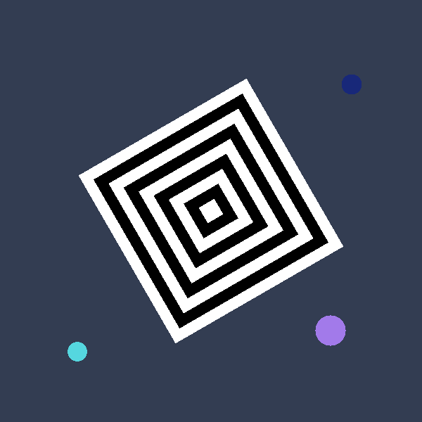
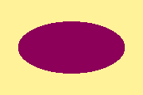
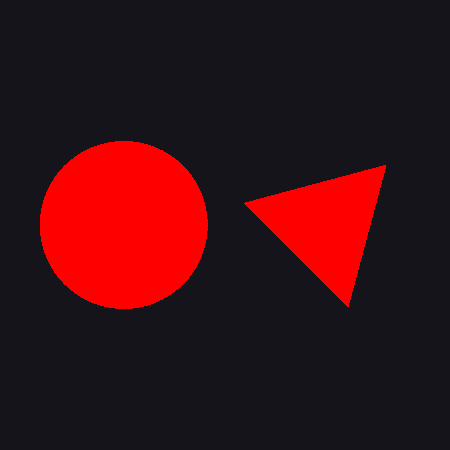
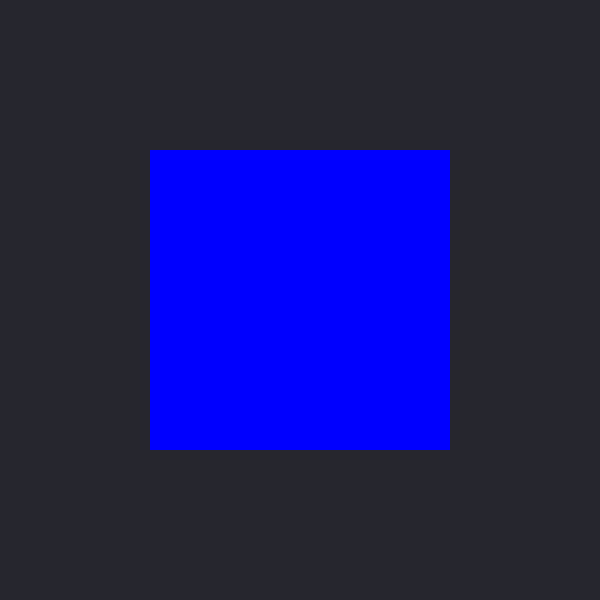
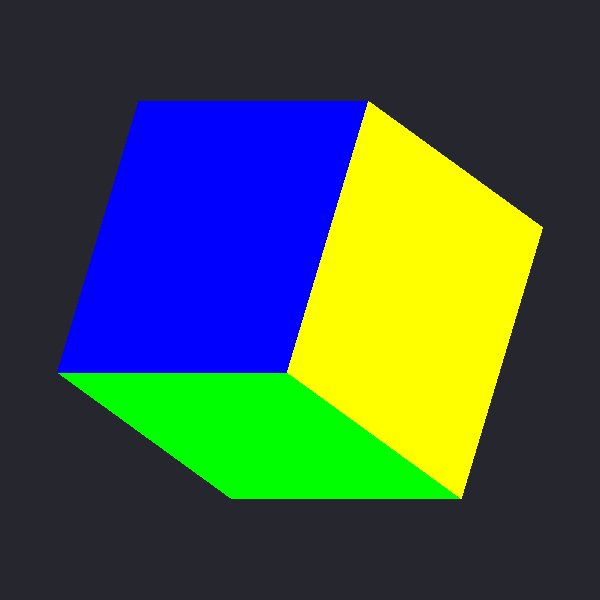
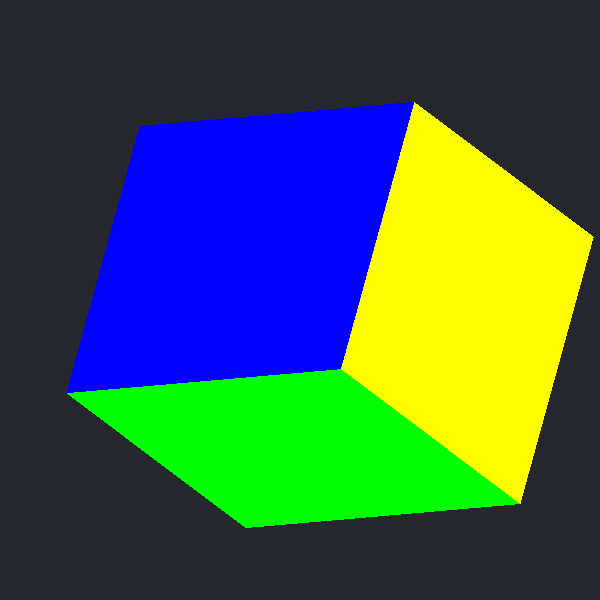

# Assignment 2 Report

**Student:** Beknur Tanibergen  
**Course:** Computer Graphics  
**OS used for testing:** macOS, OpenGL 4.1 Core + Apple GLUT

---

## 1. Development environment

1. Assignment 1 used GLFW, which has no menus or sub-windows. Assignment 2 switches to
   **GLUT** (the `GLUT.framework` that ships with macOS) because it provides
   `glutCreateMenu`, `glutCreateSubWindow`, `glutIdleFunc` and the other callbacks
   the assignment is about.
2. `glutInitDisplayMode(GLUT_3_2_CORE_PROFILE | ...)` gives a core profile context,
   so the same modern pipeline (`#version 410 core`, VAOs/VBOs, shaders) as in
   Assignment 1 is used. No deprecated drawing functions are used.
3. Shared helpers live in `src/common.cpp`: shader loading, mesh upload, a small
   column-major `Mat4` type with `translate`, `scale`, `rotateX/Y/Z`.
4. `make` builds both programs: `interaction` and `cube`.

---

## 2. Part 1 — Interaction, Windows, Menus and Animation (`interaction`)

Shaders: `vshader2d.glsl` multiplies `vPosition` by a `uModel` matrix and takes the
color from a `uColor` uniform; `fshader.glsl` outputs it. Every shape is uploaded once
as a unit shape and positioned / rotated / scaled with `uModel`.

Each GLUT window and sub-window has its **own OpenGL context**, so the shader program
and the VAOs are created separately for each one (`Renderer` struct per window).

### 2.1 Double buffering

`GLUT_DOUBLE` is passed to `glutInitDisplayMode`. All drawing goes into the back
buffer and every display callback ends with `glutSwapBuffers()`, so the animation
does not flicker.

### 2.2 Main window — the black & white square

The nested square from Assignment 1 (angle construction `π/4 + kπ/2`, 9 layers,
alternating white/black) is drawn in a 600×600 main window on a dark blue background.



*(screenshot of the main window's own framebuffer; the extra-credit circles are visible,
the sub-window is a separate context and is shown below)*

### 2.3 Sub-window with an ellipse

`glutCreateSubWindow(mainWin, 12, 12, 180, 120)` places a sub-window in the top-left
corner of the main window. Its display function `subDisplay` clears to its own
background color (light yellow by default) and draws an ellipse
(`x = 0.75 cos θ`, `y = 0.55 sin θ`, `GL_TRIANGLE_FAN`).



### 2.4 Sub-window menu

While the sub-window is the current window, `glutCreateMenu(subMenu)` +
`glutAttachMenu(GLUT_RIGHT_BUTTON)` attach a menu **only to the sub-window**:
Light Yellow, Light Cyan, Pink, Gray, White. The callback changes `gSubBackground`
and calls `glutPostRedisplay()` for the sub-window.

### 2.5 "window 2" — circle and triangle

A second top-level window titled **"window 2"** draws a circle and a triangle with one
shared color `gWin2Color`. Its keyboard callback maps
`r` red, `g` green, `b` blue, `y` yellow, `o` orange, `p` purple, `w` white.



### 2.6 Animation with the idle callback

`glutIdleFunc(idle)` is registered at start-up. `idle()` measures the time since the
last call (`glutGet(GLUT_ELAPSED_TIME)`) and updates:

| Object | Update | Effect |
|---|---|---|
| Squares | `squareAngle += 40°/s`, model `Rz(squareAngle)` | counter-clockwise rotation |
| Triangle | `triangleAngle -= 60°/s`, model `T · Rz(triangleAngle) · S` | clockwise rotation |
| Circle | `phase += 2.5 rad/s`, scale `1 + 0.35 sin(phase)` | grows and shrinks ("breathing") |

Then it calls `glutPostRedisplay()` on the main window, the sub-window and window 2.

### 2.7 Main window menu

Right-click menu on the main window, built with a sub-menu:

```
Stop Animation        -> glutIdleFunc(NULL)
Start Animation       -> glutIdleFunc(idle)   (timer reset so nothing jumps)
Square Colors ->
    White             -> white & black squares (original)
    Red               -> red & black squares
    Green             -> green & black squares
```

Stopping uses a `NULL` idle callback, so all animation in every window stops.

### 2.8 Extra credit — click to add breathing circles

`glutMouseFunc(mainMouse)` on the main window handles left clicks. The click position
is converted from window pixels to clip coordinates:

```
x_ndc = 2x / width - 1
y_ndc = 1 - 2y / height
```

A circle with a random color and a random breathing phase is added at that point and
breathes together with the animation (see the three circles in the main window
screenshot).

---

## 3. Part 2 — 3D Transformations and Geometry (`cube`)

### 3.1 Cube geometry and color

The lecture `colorcube`: 8 vertices at `±0.5`, 8 vertex colors (black, red, yellow,
green, blue, magenta, white, cyan), and six `quad(a,b,c,d)` calls. Each quad is two
triangles (36 vertices total) and takes the color of its first vertex, so every face
has a solid color.

### 3.2 Depth test

The window is created with `GLUT_DEPTH`, `glEnable(GL_DEPTH_TEST)` is called, and
every frame clears `GL_COLOR_BUFFER_BIT | GL_DEPTH_BUFFER_BIT`, so hidden faces are
removed correctly.

### 3.3 Transformation menu

Right-click menu: **SCALE**, **ROTATE**, **TRANSLATE**. It selects which transformation
the keys modify. The current mode and its delta are shown in the window title (not in
the terminal, because the instructions must be the only terminal output).

### 3.4 Model matrix (scale → rotate → translate)

On every update the application builds

```
S = scale(sx, sy, sz)
R = Rz(θz) · Ry(θy) · Rx(θx)
T = translate(tx, ty, tz)
M = T · R · S
```

`M` is sent as the `uModel` uniform and applied in the vertex shader:

```glsl
gl_Position = uModel * vPosition;
```

No camera or projection matrix is used, so the default orthographic view volume
(`-1..1` in x, y, z) applies. Translating along Z therefore does not change the
cube's size; the cube is only clipped if it leaves the view volume.

### 3.5 Keys

| Key | Action |
|---|---|
| `q` / `a` | +/- X component of the current transformation |
| `w` / `s` | +/- Y component |
| `e` / `d` | +/- Z component |
| `+` / `-` | doubles / halves the delta of the current transformation |
| `r` | resets all transformations and deltas |

Each transformation has its own delta (defaults: scale `0.1`, rotate `5°`,
translate `0.05`). The cube changes only on a key stroke: the keyboard callback
updates the values and calls `glutPostRedisplay()`; there is no idle callback.

The program prints the instructions to the terminal at start-up; that is its only
text output.

### 3.6 Results

| Start (identity) | Rotated | Scaled + rotated + translated |
|---|---|---|
|  |  |  |

With the identity transformation only one face is visible (the view looks straight
down the Z axis). In clip space a larger z is farther away, so the face at `z = -0.5`
(blue) is the one in front.

---

## 4. Files

```
src/common.h / common.cpp   shaders, meshes, Mat4 helpers, PPM screenshot
src/interaction.cpp         Part 1 (windows, sub-window, menus, animation, extra credit)
src/cube.cpp                Part 2 (3D cube transformations)
shaders/vshader2d.glsl      2D vertex shader (uModel + uColor)
shaders/vshader_cube.glsl   cube vertex shader (uModel applied to vertices)
shaders/fshader.glsl        fragment shader
report_figures/             screenshots used in this report
Makefile                    default target builds both programs
README.md                   build / run / controls
REPORT.md                   this file
```
